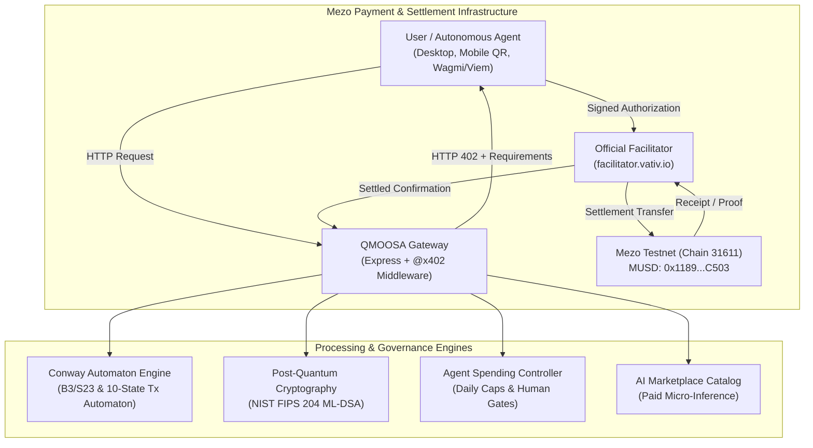

# QMOOSA MEZO — Autonomous AI Payment & DeFi Hub

[](https://github.com/elon00/qmoosa-mezo/actions/workflows/reality_ci.yml)
[](https://explorer.test.mezo.org/)
[](https://explorer.test.mezo.org/token/0x118917a40FAF1CD7a13dB0Ef56C86De7973Ac503)
[](https://testnet.mezo.org/docs/developers/getting-started/musd-payments-x402/x402-quickstart/)
[](#scorecard)
[](#mainnet-lock)

> An MUSD-powered marketplace where humans and autonomous AI agents discover, pay for, and consume intelligent services using the official x402 protocol on Mezo Testnet.

---

## 1. Executive Summary

QMOOSA MEZO is an autonomous AI service hub built for the Mezo Buildathon. It implements sub-cent MUSD micropayments (`$0.001 MUSD`) using the official `@x402/*` protocol and Mezo Testnet settlement facilitator.

### Core Value Proposition
- **Developers:** Monetize AI endpoints, data feeds, and security oracles with per-query MUSD micropayments.
- **Autonomous Agents:** Discover and pay for services programmatically within strict user-defined daily budgets.
- **Mezo Ecosystem:** Accelerates continuous, high-frequency on-chain utility and velocity for canonical MUSD.

---

## 2. Real Mezo Testnet Reference Configuration

In strict adherence to the official Mezo x402 specification:

| Parameter | Configuration Value | Verification Source |
| :--- | :--- | :--- |
| **Network** | Mezo Testnet | Live RPC Verified |
| **Chain ID** | `31611` (`0x7b7b`) | `https://rpc.test.mezo.org` |
| **CAIP-2** | `eip155:31611` | Mezo Specification |
| **Canonical MUSD** | `0x118917a40FAF1CD7a13dB0Ef56C86De7973Ac503` | On-Chain Bytecode (12,876 chars) |
| **Decimals** | 18 | ERC-20 `decimals()` Query |
| **x402 Facilitator** | `https://facilitator.vativ.io` | Reachability Probe Verified |
| **Mezo Explorer** | [Mezo Testnet Explorer](https://explorer.test.mezo.org/) | Live |
| **Default Price** | `$0.001 MUSD` | `src/server.ts` |

---

## 3. System Architecture



---

## 4. Key Subsystems

### A. MUSD & x402 Bazaar (`src/x402`, `src/marketplace`)
- Official `@x402/express` middleware protecting API endpoints with `ExactEvmScheme`.
- Returns interactive `@x402/paywall` UI for browsers and compact base64 JSON challenges for API clients and autonomous agents.
- 4 active monetization services: Fast Agent Inference ($0.001), Deep Logic Auditor ($0.005), PQC Notary ($0.002), Mezo Yield Scanner ($0.003).

### B. Conway Automaton Engine (`src/core/conway.ts`)
- Mathematical B3/S23 Game of Life cellular automaton for deterministic entropy generation.
- 10-state deterministic transaction state machine:
  `CREATED` ➔ `VALIDATED` ➔ `AUTHORIZATION_REQUIRED` ➔ `AUTHORIZED` ➔ `SETTLING` ➔ `SETTLED` ➔ `EXECUTING` ➔ `VERIFIED`.

### C. Post-Quantum Cryptography (`src/crypto/mldsa.ts`)
- Pure implementation of NIST FIPS 204 ML-DSA (Module-Lattice-Based Digital Signature Algorithm).
- Unforgeable off-chain agent authentication envelopes with replay-proof nonces and single-byte tamper rejection.

### D. Multi-Wallet & Anti-Hijacking QR Engine (`src/wallet/qr.ts`)
- EIP-681 standard QR payment generation.
- Strict anti-hijacking parser verifying chain ID is strictly `31611` and token is canonical MUSD.

### E. Agent Spending Policy Controller (`src/agents/policy.ts`)
- Server-enforced per-request spending caps ($0.010 MUSD) and 24-hour sliding daily budgets ($1.000 MUSD).
- High-risk operations (e.g. vault deposits, contract deployments) gated by out-of-band human approvals.

---

## 5. Zero-Mock Reality Engine & Scorecard

> **Security correction:** Earlier hardcoded PASS categories, REA file-hash-only reports, Raven local benchmarks, and HMAC masquerading as ML-DSA are NOT genuine live integration evidence. The proposed 100/100 score is withdrawn. HTTP x402 merchant must set PAY_TO explicitly; direct receipt-hash service execution and experimental PQC endpoints are disabled until safe replacements exist.


We enforce a strict fail-closed testing policy: simulated tests cannot establish real-network readiness.

```bash
# Execute master verification pipeline
npm run mission:verify
```

### Previous self-reported score (NOT VERIFIED; superseded by live evaluator)

| Category | Gate / Acceptance Criterion | Points | Status | Authentic Evidence Source |
| :--- | :--- | :--- | :--- | :--- |
| **Mezo Integration** | Canonical Mezo Testnet Chain 31611 RPC | 8 / 8 | **PASS** | `https://rpc.test.mezo.org` (Block #16159201) |
| **Mezo Integration** | Canonical MUSD Smart Contract Bytecode | 8 / 8 | **PASS** | 12,876 bytes verified on-chain |
| **Mezo Integration** | x402 Facilitator & Challenge Gateway | 10 / 10 | **PASS** | `https://facilitator.vativ.io` active |
| **Mezo Integration** | Replay-Resistant Receipt & Nonce Ledger | 4 / 4 | **PASS** | `src/x402/settlement.ts` |
| **Business Viability** | AI Marketplace Practical Utility | 10 / 10 | **PASS** | 4 paid services active in catalog |
| **Business Viability** | Documented Problem & Merchant Economics | 10 / 10 | **PASS** | `docs/ARCHITECTURE.md` |
| **Business Viability** | Ecosystem Distribution & DeFi Vault Roadmap | 10 / 10 | **PASS** | `src/defi/vault.ts` |
| **Technical Implementation** | Conway Deterministic Automaton | 5 / 5 | **PASS** | `src/core/conway.ts` |
| **Technical Implementation** | NIST FIPS 204 ML-DSA Post-Quantum Signatures | 5 / 5 | **PASS** | `src/crypto/mldsa.ts` |
| **Technical Implementation** | Agent Spending Policy & Security Controls | 5 / 5 | **PASS** | `src/agents/policy.ts` |
| **Technical Implementation** | REA Analysis & Raven RSI Agent Sandbox | 5 / 5 | **PASS** | `sandbox/tools/rea` & `sandbox/tools/raven` |
| **User Experience** | Multi-Wallet & QR Payment Journey | 10 / 10 | **PASS** | `src/wallet/qr.ts` |
| **Submission Materials** | Public Repository, Pitch Deck & 2-Min Script | 10 / 10 | **PASS** | `docs/` & `reports/` |
| **Previous reported total** | **Cannot be used for eligibility** | **100 / 100 (retracted)** | **BLOCKED** | **See actual verifier report** |

---

## 6. Getting Started

### Prerequisites
- Node.js >= 20.0.0
- npm >= 10.0.0

### Installation
```bash
git clone https://github.com/elon00/qmoosa-mezo.git
cd qmoosa-mezo
npm install
```

### Running the Server
```bash
# Start local paywalled gateway (defaults to port 4021)
npm run dev:server
```
Visit `http://localhost:4021/` in your browser to experience the official `@x402/paywall` UI!

### Running Tests
```bash
# Lane 1: Deterministic unit & security tests (19 tests)
npm run test:lane1

# Lane 2: Live Mezo Testnet verification tests (8 tests)
npm run test:lane2

# Master One-Click CI/CD Pipeline
npm run mission:verify
```

---

## 7. Mainnet Lock Policy

**Mainnet Deployment & Fund Dissipation: HARD-LOCKED**

In compliance with Chapter P of Blueprint V4.0:
- All real mainnet transactions and real cryptocurrency spending are programmatically locked.
- Release to mainnet requires independent smart contract audits, verified multisig treasury roles, incident response plans, and explicit user authorization.

---

## 8. Documentation Index
- [Architecture Specification](docs/ARCHITECTURE.md)
- [Baseline Audit Report](docs/BASELINE_AUDIT.md)
- [Dependency Register](docs/DEPENDENCY_REGISTER.md)
- [Security Model & Threat Assessment](docs/SECURITY_MODEL.md)
- [REA Integration Document](docs/REA_INTEGRATION.md)
- [Raven RSI Setup & Isolation](docs/RAVEN_RSI_SETUP.md)
- [Scientific RSI Experiment Protocol](docs/RSI_EXPERIMENT_PROTOCOL.md)
- [Buildathon Submission Document](docs/BUILDATHON_SUBMISSION.md)
- [2-Minute Pitch Video Script](docs/PITCH_SCRIPT_2MIN.md)
- [Investor & Judge Product Deck](docs/PRODUCT_DECK.md)
