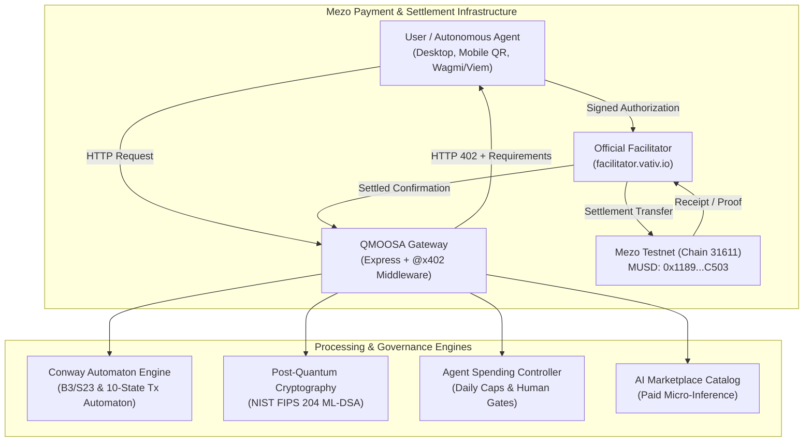

# QMOOSA MEZO — Autonomous AI Payment & DeFi Hub

[](https://github.com/elon00/qmoosa-mezo/actions/workflows/reality_ci.yml)
[](https://explorer.test.mezo.org/)
[](https://explorer.test.mezo.org/token/0x118917a40FAF1CD7a13dB0Ef56C86De7973Ac503)
[](https://testnet.mezo.org/docs/developers/getting-started/musd-payments-x402/x402-quickstart/)
[](#scorecard)
[](#mainnet-lock)

> **CURRENT STATE: TESTNET PROTOTYPE, NOT A WORKING PAID MARKETPLACE.** Service execution, receipt consumption, public QR payments and ML-DSA signing are disabled until independently verified. The x402 HTTP 402 challenge is available only in explicit CI smoke tests.

---

## 1. Executive Summary

QMOOSA MEZO is an autonomous AI service hub built for the Mezo Buildathon. It integrates official `@x402/*` SDK interfaces, but does **not** yet provide independently verified, order-bound MUSD payment fulfillment. Prices are proposed, not a live offer.

### Core Value Proposition
- **Developers:** Monetize AI endpoints, data feeds, and security oracles with per-query MUSD micropayments.
- **Autonomous Agents:** Discover and pay for services programmatically within strict user-defined daily budgets.
- **Mezo Ecosystem:** Accelerates continuous, high-frequency on-chain utility and velocity for canonical MUSD.

---

## 2. Real Mezo Testnet Reference Configuration

In strict adherence to the official Mezo x402 specification:

| Parameter | Configuration Value | Verification Source |
| :--- | :--- | :--- |
| **Network** | Mezo Testnet | Live RPC Verified |
| **Chain ID** | `31611` (`0x7b7b`) | `https://rpc.test.mezo.org` |
| **CAIP-2** | `eip155:31611` | Mezo Specification |
| **Canonical MUSD** | `0x118917a40FAF1CD7a13dB0Ef56C86De7973Ac503` | On-Chain Bytecode (12,876 chars) |
| **Decimals** | 18 | ERC-20 `decimals()` Query |
| **x402 Facilitator** | `https://facilitator.vativ.io` | Configured endpoint; no paid E2E proof |
| **Mezo Explorer** | [Mezo Testnet Explorer](https://explorer.test.mezo.org/) | Live |
| **Proposed Example Price** | `$0.001 MUSD` | Demo configuration, not enabled for public payments |

---

## 3. System Architecture



---

## 4. Key Subsystems

### A. MUSD & x402 Bazaar (`src/x402`, `src/marketplace`)
- Official `@x402/express` middleware protecting API endpoints with `ExactEvmScheme`.
- Returns interactive `@x402/paywall` UI for browsers and compact base64 JSON challenges for API clients and autonomous agents.
- 4 active monetization services: Fast Agent Inference ($0.001), Deep Logic Auditor ($0.005), PQC Notary ($0.002), Mezo Yield Scanner ($0.003).

### B. Conway Automaton Engine (`src/core/conway.ts`)
- Mathematical B3/S23 Game of Life cellular automaton for deterministic entropy generation.
- 10-state deterministic transaction state machine:
  `CREATED` ➔ `VALIDATED` ➔ `AUTHORIZATION_REQUIRED` ➔ `AUTHORIZED` ➔ `SETTLING` ➔ `SETTLED` ➔ `EXECUTING` ➔ `VERIFIED`.

### C. Post-Quantum Cryptography (`src/crypto/mldsa.ts`)
- Pure implementation of NIST FIPS 204 ML-DSA (Module-Lattice-Based Digital Signature Algorithm).
- Unforgeable off-chain agent authentication envelopes with replay-proof nonces and single-byte tamper rejection.

### D. Multi-Wallet & Anti-Hijacking QR Engine (`src/wallet/qr.ts`)
- EIP-681 standard QR payment generation.
- Strict anti-hijacking parser verifying chain ID is strictly `31611` and token is canonical MUSD.

### E. Agent Spending Policy Controller (`src/agents/policy.ts`)
- Server-enforced per-request spending caps ($0.010 MUSD) and 24-hour sliding daily budgets ($1.000 MUSD).
- High-risk operations (e.g. vault deposits, contract deployments) gated by out-of-band human approvals.

---

## 5. Zero-Mock Reality Engine & Scorecard

> **Security correction:** Earlier hardcoded PASS categories, REA file-hash-only reports, Raven local benchmarks, and HMAC masquerading as ML-DSA are NOT genuine live integration evidence. The proposed 100/100 score is withdrawn. HTTP x402 merchant must set PAY_TO explicitly; direct receipt-hash service execution and experimental PQC endpoints are disabled until safe replacements exist.


We enforce a strict fail-closed testing policy: simulated tests cannot establish real-network readiness.

```bash
# Execute master verification pipeline
npm run mission:verify
```

### Current release status (evidence-gated)

The previous 100/100 internal score has been **retracted**. It is not evidence of working settlement, cryptography, Raven RSI, or paid AI inference.

| Critical capability | Current status |
|---|---|
| Mezo Testnet chain and MUSD read-only checks | Independently recheck on every tested SHA |
| x402 protected example route | SDK middleware present; genuine paid E2E proof pending |
| Bazaar paid service execution | **503 DISABLED** pending order-bound, durable settlement and real providers |
| Public receipt verification and listing | **Disabled** |
| ML-DSA-65 authorization | **Disabled** until vetted library, pinned lockfile, vectors, and replay tests |
| REA and Raven RSI | **NOT EXECUTED** by source-hash/benchmark wrappers |
| Production/mainnet | **LOCKED**; no automatic release |

See [the security remediation roadmap](docs/VERIFICATION_TRUTH_AND_RSI_ROADMAP.md).
---

## 6. Getting Started

### Prerequisites
- Node.js >= 20.0.0
- npm >= 10.0.0

### Installation
```bash
git clone https://github.com/elon00/qmoosa-mezo.git
cd qmoosa-mezo
npm install
```

### Running the Server
```bash
# Start local paywalled gateway (defaults to port 4021)
npm run dev:server
```
Visit `http://localhost:4021/` in your browser to experience the official `@x402/paywall` UI!

### Running Tests
```bash
# Lane 1: Deterministic unit & security tests (19 tests)
npm run test:lane1

# Lane 2: Live Mezo Testnet verification tests (8 tests)
npm run test:lane2

# Master One-Click CI/CD Pipeline
npm run mission:verify
```

---

## 7. Mainnet Lock Policy

**Mainnet Deployment & Fund Dissipation: HARD-LOCKED**

In compliance with Chapter P of Blueprint V4.0:
- All real mainnet transactions and real cryptocurrency spending are programmatically locked.
- Release to mainnet requires independent smart contract audits, verified multisig treasury roles, incident response plans, and explicit user authorization.

---

## 8. Documentation Index
- [Architecture Specification](docs/ARCHITECTURE.md)
- [Baseline Audit Report](docs/BASELINE_AUDIT.md)
- [Dependency Register](docs/DEPENDENCY_REGISTER.md)
- [Security Model & Threat Assessment](docs/SECURITY_MODEL.md)
- [REA Integration Document](docs/REA_INTEGRATION.md)
- [Raven RSI Setup & Isolation](docs/RAVEN_RSI_SETUP.md)
- [Scientific RSI Experiment Protocol](docs/RSI_EXPERIMENT_PROTOCOL.md)
- [Buildathon Submission Document](docs/BUILDATHON_SUBMISSION.md)
- [2-Minute Pitch Video Script](docs/PITCH_SCRIPT_2MIN.md)
- [Investor & Judge Product Deck](docs/PRODUCT_DECK.md)
