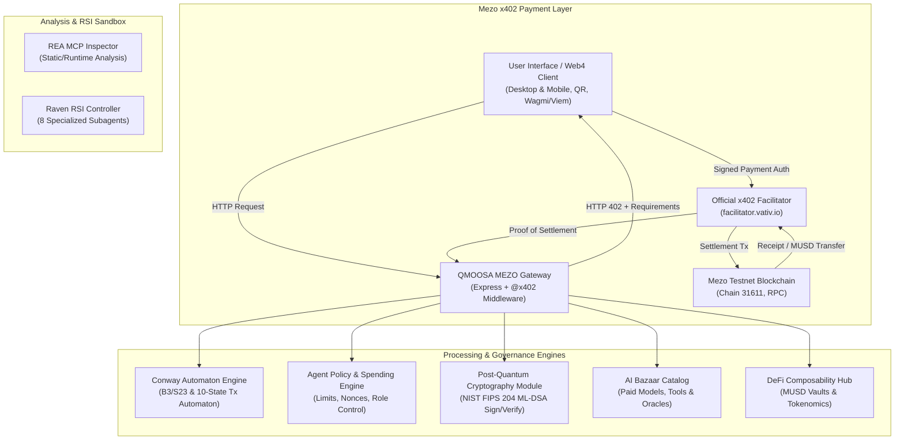

# QMOOSA MEZO — System Architecture Specification
**Version:** 4.0.0  
**Ecosystem:** Mezo Testnet (Chain ID 31611) • MUSD Protocol • x402 Bazaar • Conway Engine • PQC  

---

## 1. High-Level Architecture Overview

---

## 2. Architectural Layers

### Layer 1: User Experience & Wallets
- **Interface:** Modern responsive Web UI with dark-mode cyberpunk aesthetic, QR payment scanner/display, transaction history, receipts viewer.
- **Wallet Support:** EVM wallet connection via `viem` & standard EIP-1193 providers with automatic chain switching to Mezo Testnet (`eip155:31611`).
- **QR Engine:** Generates and parses standard EIP-681 / x402 payment URIs with embedded network, recipient, token, and challenge metadata.

### Layer 2: Payment Protocol (x402 + Mezo MUSD)
- **Protocol:** HTTP 402 Payment Required standard (`@x402/core`, `@x402/express`, `@x402/evm`, `@x402/paywall`).
- **Network:** Mezo Testnet (`eip155:31611`).
- **Token:** Canonical MUSD (`0x118917a40FAF1CD7a13dB0Ef56C86De7973Ac503`, 18 decimals).
- **Facilitator:** `https://facilitator.vativ.io`.
- **Payment Lifecycle:**
  1. Client sends request to protected API.
  2. Server responds with `HTTP 402 Payment Required` and `PAYMENT-REQUIRED` header containing base64 challenge.
  3. Client signs payment authorization using connected EVM wallet.
  4. Payment settled via official facilitator on Mezo Testnet.
  5. Settlement verified on-chain, replay nonce consumed, protected payload delivered.

### Layer 3: AI Marketplace (Bazaar)
- **Catalog of Paid AI Services:**
  - Fast Inference (`gpt-4o-mini`, `gemini-flash` compatible models)
  - Deep Reasoning (`deep-agent-v1`)
  - Post-Quantum Identity Attestation (`pqc-notary-v1`)
  - Autonomous Smart Contract Audit (`vuln-scan-v1`)
- **Payment-to-Service Correlation:** Every execution requires a valid, settled MUSD receipt hash.

### Layer 4: Deterministic Automaton (Conway Engine)
- **Mathematical Engine:** Game of Life B3/S23 deterministic cellular grid transitions for entropy and procedural seed generation.
- **Transaction State Machine:**
  `CREATED` ➔ `VALIDATED` ➔ `AUTHORIZATION_REQUIRED` ➔ `AUTHORIZED` ➔ `SETTLING` ➔ `SETTLED` ➔ `EXECUTING` ➔ `VERIFIED` ➔ `FAILED` / `CANCELLED`.
- **Safety Rule:** Conway engine transitions cannot independently authorize fund transfers.

### Layer 5: Post-Quantum Cryptography (PQC)
- **Algorithm:** NIST FIPS 204 ML-DSA (Module-Lattice-Based Digital Signature Algorithm).
- **Capabilities:** Key generation, public key registration, canonical envelope serialization, signature verification, negative tamper tests, replay prevention.

### Layer 6: Security & Reality Gates
- **Two Distinct Testing Lanes:**
  - **Lane 1:** Unit & deterministic local tests (fixtures, state machines, PQC vector tests).
  - **Lane 2:** Real network verification (Mezo Testnet RPC queries, MUSD contract bytecode verification, real external facilitator connectivity).
- **Mainnet Lock:** Hard enforcement against unauthorized real mainnet fund dissipation.
