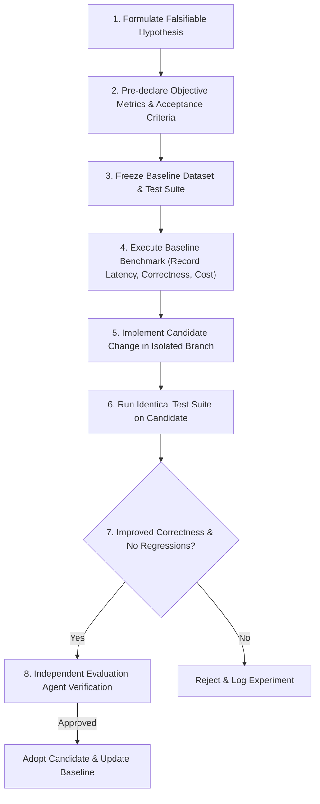

# QMOOSA MEZO — Scientific RSI Experiment Protocol
**Standard:** Controlled, Measurable, Evidence-Based Recursive Self-Improvement  
**Baseline Standard:** Zero-Mock Reality Engine  

---

## 1. The Scientific Experiment Cycle

---

## 2. Predeclared Evaluation Metrics

1. **Payment Verification Correctness:** Percentage of valid x402 payment authorizations correctly verified without false rejections. Target: 100%.
2. **False Acceptance Rate (FAR):** Percentage of invalid, tampered, or expired authorizations accepted. Target: 0.00%.
3. **False Rejection Rate (FRR):** Percentage of legitimate authorizations rejected due to verification latency or race condition. Target: 0.00%.
4. **Diagnosis & Triage Latency:** Mean milliseconds to diagnose an unavailable RPC or invalid transaction format.
5. **Deterministic State Invariant Preservation:** Percentage of Conway state machine transitions conforming to legal graph edges. Target: 100%.
6. **PQC Tamper Detection:** Percentage of single-byte corrupted signatures rejected. Target: 100%.

---

## 3. Experiment Registry
All completed experiments, including negative and rejected results, must be recorded in `reports/RSI_EXPERIMENTS.json` with execution hashes, CPU/memory measurements, and delta evaluations.
